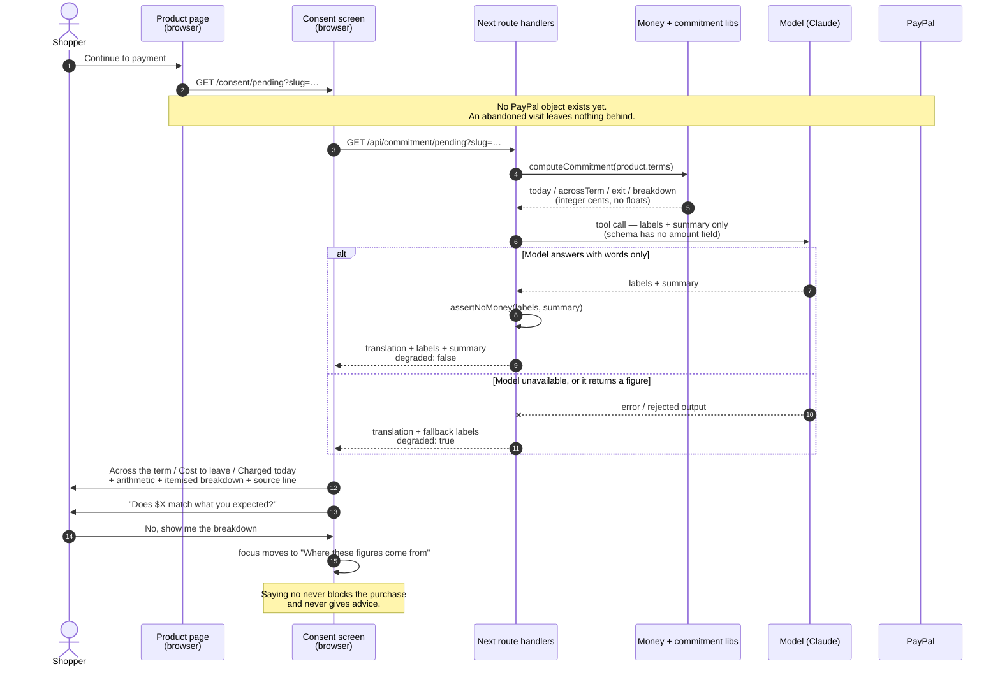
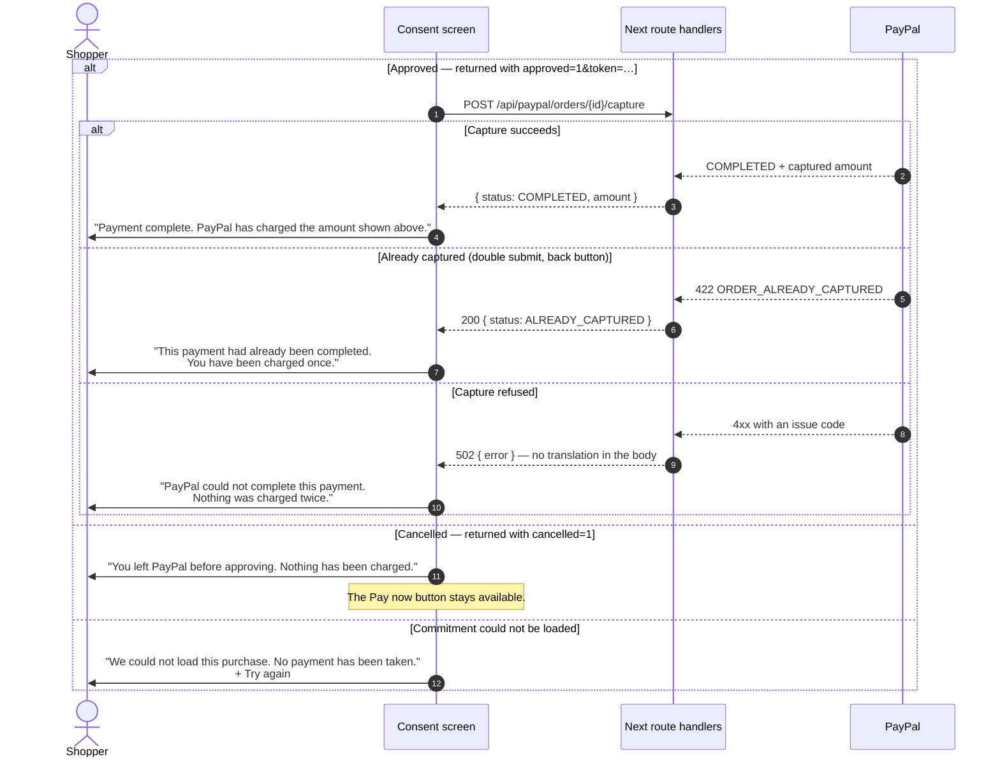

# Consent screen — sequence of a purchase

> **Scope:** this covers the purchase and subscription doors only. The bill and document doors, and
> the front door that leads to all four, are diagrammed in
> `../universal-commitment-companion/flows.md`.

**What this document is:** a reading aid, not a decision record. It shows the order of events
between the storefront, our server, the model, and PayPal for a single purchase. The decisions
behind each step live in the IPDs and ITDs under this folder.

**One rule that shapes everything below:** the money is computed by our code; the model only ever
writes words. It is called with a tool schema that has no monetary field, and its output is
rejected if it contains a figure-shaped string.

---

## 1. What the shopper sees before approving



The three figures are the whole point: a single total does not answer *what am I taking on*, and
the cost of leaving is the figure most often missing from a page like this. When the seller has
not published it, the screen says **"Not stated"** rather than inventing `$0.00`.

---

## 2. What happens when the shopper asks to pay

```mermaid
sequenceDiagram
    autonumber
    actor S as Shopper
    participant C as Consent screen
    participant API as Next route handlers
    participant PP as PayPal
    Note over C,PP: Nothing is stored: the order id travels in the URL.

    S->>C: Pay now
    C->>C: set payment state "paying"

    alt Repeating commitment (coffee)
        C->>API: POST /api/paypal/subscriptions {slug}
        API->>PP: ensure product + billing plan (idempotent;<br/>DUPLICATE_RESOURCE = success)
        API->>PP: POST /v1/billing/subscriptions
        PP-->>API: subscription id + links[rel=approve]
        API-->>C: { subscriptionId, approveUrl }
    else One-time or financed commitment
        C->>API: POST /api/paypal/orders {slug}
        API->>API: computeCommitment → today
        API->>PP: POST /v2/checkout/orders<br/>intent CAPTURE + return_url + cancel_url
        PP-->>API: order id, amount, links[rel=approve]
        API->>API: drift guard — returned amount must equal<br/>the amount we asked for
        API-->>C: { orderId, approveUrl, translation }
    end

    C->>S: "Approve … with PayPal" (link, same tab)
    S->>PP: approve on PayPal's own page
    PP-->>S: redirect to /consent/pending?approved=1&token=…
```

Both shapes end the same way: the shopper authorises the payment **on PayPal**, and PayPal is the
one that records consent. Our screen never holds card details and never calls a capture on an
unapproved order — PayPal rejects that with `ORDER_NOT_APPROVED`, which is the correct answer.

---

## 3. Coming back, and the paths that go wrong



A failed payment never carries the figures with it: a total PayPal has not agreed to is worse than
no total at all.

---

## Endpoints involved

| Endpoint | Purpose | Creates anything at PayPal? |
|---|---|---|
| `GET /api/commitment/[orderId]?slug=` | Translation + labels + summary, or a degraded answer | No |
| `POST /api/paypal/orders` | One-time or financed order + approval link | Yes — order |
| `POST /api/paypal/subscriptions` | Catalog product, billing plan, subscription + approval link | Yes — product, plan, subscription |
| `POST /api/paypal/orders/[id]/capture` | Takes the money once the payer has approved | Moves money |

---

## Reading the code

| Step | File |
|---|---|
| Figures | `lib/commitment/compute.ts`, `lib/money.ts` |
| Model call and its schema | `lib/ai/extract-terms.ts` |
| Refusal of model-written money | `lib/ai/guard.ts` |
| Screen and payment hand-off | `components/ConsentScreen.tsx` |
| PayPal order + drift guard | `lib/paypal/orders.ts` |
| Plans and subscriptions | `lib/paypal/subscriptions.ts` |
