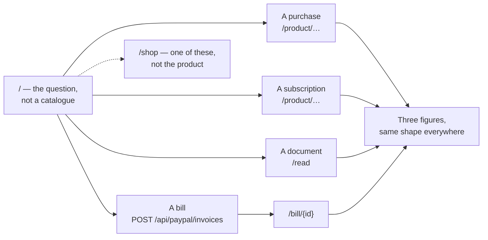
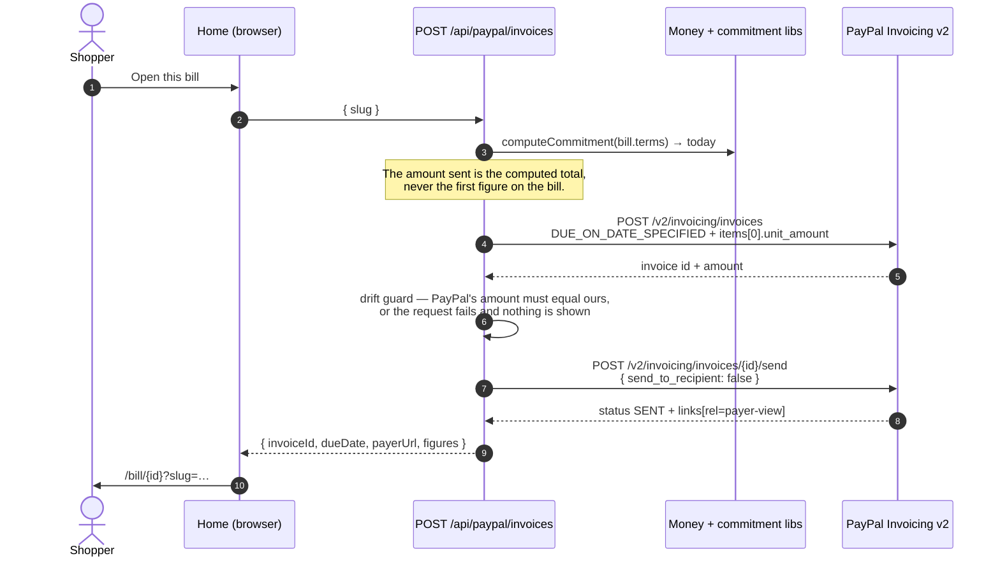
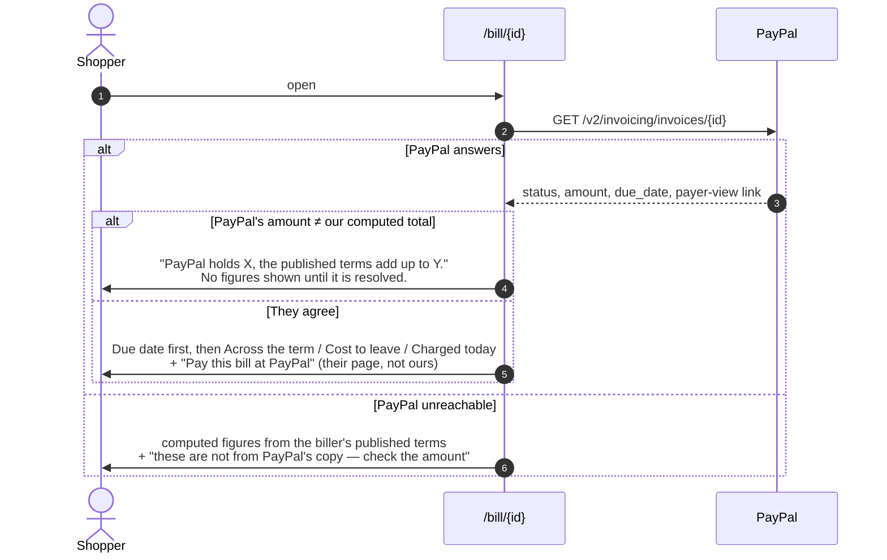
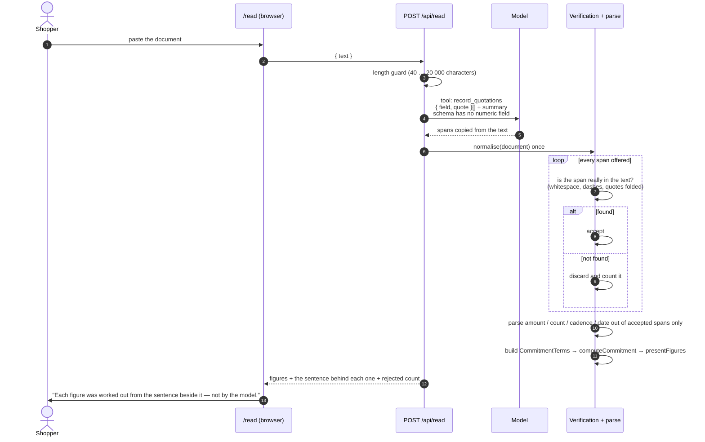
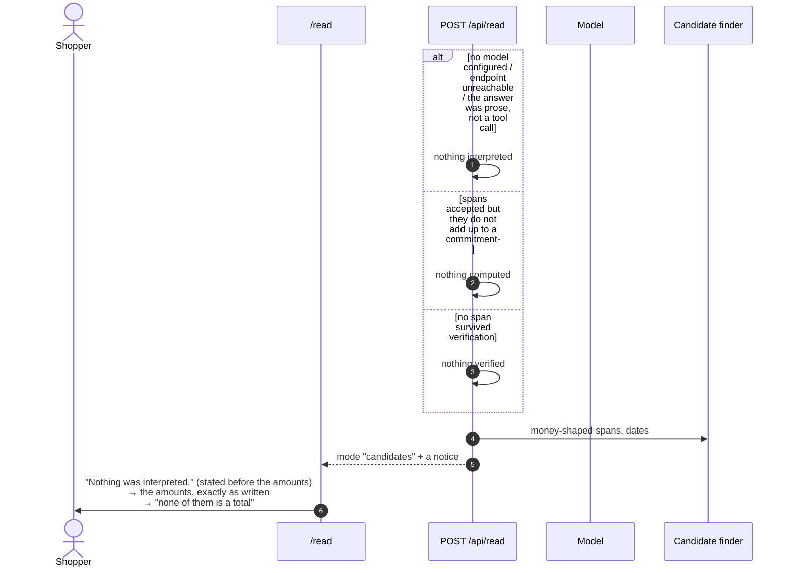

# The four ways in — how each one works

**What this document is:** a reading aid, not a decision record. It shows the order of events behind
each door on the home page. The decisions live in the IPDs and ITDs beside it — this file only
follows the code.

**The rule that holds on every path below:** a figure is computed by our code, from an amount the
processor stated or a span of text we verified. The model writes words and points at sentences. Its
schemas have no monetary field, and every string it returns crosses `lib/ai/guard.ts` or a substring
check before it can reach a screen.

---

## 0. The front door

Each door prints its own real figure before anything is clicked, so the shape of the product is
visible without entering it (IPD 12).

---

## 1. A bill — the only door that creates something at PayPal first

A bill exists because a biller issued it. There is nothing to read until PayPal has one, so this is
the one path where the shopper's click is what brings the object into being.

Then the bill screen reads it back, because a bill is the biller's to change:

---

## 2. A document — the model may only quote

The shopper's own text is the source, so the numbers are *in the text*. The model is not asked what
they mean. It is asked to copy the sentences that state a commitment, and the server throws away
every quotation it cannot find in the text.

Two rules the diagram is making visible:

- **A quotation is a citation, not a claim.** `document.includes(quote)` is a substring check that
  cannot be talked around. A model that invents `$420.00` produces a span that is not in the text,
  and the span is discarded before anything is read out of it.
- **A figure without a sentence behind it is absent, not estimated.** The total across the term is
  blanked with its own explanation when the document never says how many payments there are.

### 2a. When nothing can be verified — candidate mode

ITD 12. The degraded state shares the verified state's shape: the spans that were used, each beside
what it was used for, with the totals marked absent rather than estimated.

A summary the model writes that contains a figure is not one of these cases: the summary alone is
dropped and the verified figures still render, because the spans were checked independently of it.

The notice is in the reading order **before** the amounts, because a shopper who does not notice
they are in the degraded state would read a list of numbers as an answer.

---

## Endpoints involved

| Endpoint | Door | Purpose | Creates anything at PayPal? |
|---|---|---|---|
| `GET /api/commitment/{orderId}?slug=` | Purchase, subscription | Translation + labels, or a degraded answer (`orderId` is the literal `pending` before payment) | No |
| `GET /api/commitment/[orderId]?slug=` | Receipt | The same projection for a settled payment | No |
| `POST /api/paypal/orders` | Purchase | One-time or financed order + approval link | Yes — order |
| `POST /api/paypal/subscriptions` | Subscription | Catalog product, billing plan, subscription | Yes — product, plan, subscription |
| `POST /api/paypal/orders/[id]/capture` | Purchase | Takes the money once the payer approved | Moves money |
| `POST /api/paypal/invoices` | Bill | Draft invoice, sent; returns the payer link | Yes — invoice |
| `GET /bill/[invoiceId]` | Bill | Re-reads the invoice from PayPal and renders it | No |
| `POST /api/read` | Document | Verifies quotations, returns figures or candidates | No — and keeps nothing |

---

## Reading the code

| Step | File |
|---|---|
| Figures | `lib/commitment/compute.ts`, `lib/money.ts` |
| Figure order, labels, arithmetic lines | `lib/commitment/present.ts` |
| The schedule sentence | `lib/commitment/schedule.ts` |
| Model call that writes words | `lib/ai/extract-terms.ts` |
| Refusal of model-written money | `lib/ai/guard.ts` |
| Model call that quotes only | `lib/ai/read-document.ts` |
| Quote verification | `lib/document/normalise.ts` |
| Parsing a span | `lib/document/parse.ts` |
| Spans → terms → figures | `lib/document/read.ts` |
| What can be found without a model | `lib/document/candidates.ts` |
| PayPal invoice create + send | `lib/paypal/invoices.ts` |
| PayPal reads (order, bill, subscription) | `lib/paypal/retrieve.ts` |

The purchase and subscription paths — including what happens when a payment fails — are diagrammed in
`../accessible-commerce-companion/consent-flow.md`, which this document does not repeat.
